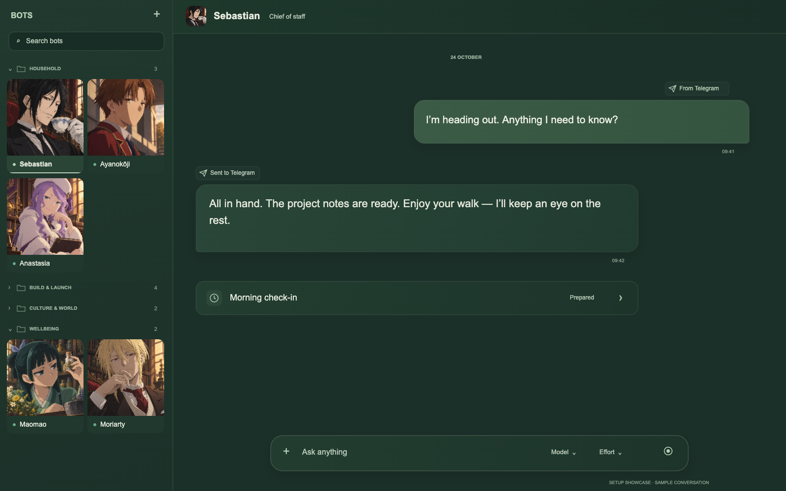

# Inner Circle Preview

**Sharing for inspiration.** This is an early community design experiment for
Hermes Desktop. If there is interest, we can polish it further together.

[Build & culture](demo/build-culture.png) · [Compact sidebar](demo/compact.png) · [Watch the 22-second demo](demo/inner-circle-demo.mp4)

*The images show the customized setup, including its character portraits and
native folders, with sample conversation text. Telegram/routine visuals show a
private adapter; that adapter is not included in this public plugin.*

An optional sage theme and desktop plugin, adapted from work with
[Hermes Bot Kit](https://github.com/thomasbek3/hermes-bot-kit).

- Wide sidebar: large portraits with a caption bar of the same width.
- Narrow sidebar: one small portrait and name per row. Drag the native divider
  below 220 CSS px to switch; widen it for the gallery.
- Compact selected-bot header, dark sage messages and a narrower composer.
- Optional Sessions hiding through the command palette; off by default.

The native roster, folders, statuses, menus and conversation history remain in
Hermes. The plugin does not create bots, send messages, run routines or alter
model settings. It uses native read-only registry metadata to identify a local
canonical Bot Chat. Ambiguous matches and remote chat sources keep stock styling.

## Try the preview

This is a manually installed experiment, not a stable release or an installer.
Use a disposable Hermes setup first. It targets the native DOM/SDK inspected in
Hermes v0.22.5; older/newer builds may render stock when their hooks differ.

1. Copy `plugin.js` to your Hermes app home's
   `desktop-plugins/inner-circle-preview/plugin.js` (normally under `~/.hermes`).
   Preserve an existing folder before replacing it. This is app-level, not a
   per-profile plugin. Avoid enabling it alongside another roster/chat reskin.
2. Reload desktop plugins from the command palette. Enable **Inner Circle
   Preview** in Settings → Plugins; it is disabled by default.
3. Optional: copy `inner-circle-sage.yaml` to your Hermes home's `skins/` folder,
   then select it with `hermes config set display.skin inner-circle-sage`.
   Record your previous skin first. The plugin itself does not change it.
4. Open a bot's native Bot Chat. Narrow/widen the sidebar using its divider.
   **Inner Circle Preview: show or hide Sessions** is available in the palette.

To remove it, disable the plugin, remove its folder and reload plugins. Select
your previous skin before removing the optional skin file. No session or profile
data needs to be deleted or restored.

## Demo and checks

`demo/index.html` is a canvas showcase of the customized setup, with its profile
artwork, bot names and native folders. Conversation text is sample data.
Serve this folder locally, for example `python3 -m http.server 8766`, and open
`http://127.0.0.1:8766/demo/`. It shows the gallery and compact layout; it is not
a recording of a live model. Its character portraits are AI-generated fan illustrations from the configured
profiles; see [demo/ASSETS.md](demo/ASSETS.md).

For the isolated tests, install the development dependency with `npm install`,
then run `npm test`. The plugin has no runtime npm dependency or build step.

The original customized Mac setup was visually checked at narrow and wide
widths. This extracted preview has isolated registry, scope, stale-read,
avatar-update and cleanup checks. A clean stock-Hermes acceptance pass and
Windows/Linux visual acceptance have **not** been completed for this extraction.
CSS depends on native markup and can need adjustment after Hermes updates.

## Scope and future interest

This first public slice is presentation only. The original setup also had
evidence-backed Telegram badges and folded routine records; those depend on a
private integration and are deliberately not included or simulated as shipped
features here. A portable, optional adapter could follow if people want it.

Useful feedback: preferred gallery/list breakpoint, keyboard/accessibility
behaviour, light-theme treatment and compatibility with current Hermes builds.
No roadmap, support schedule or merge expectation is implied by this preview.

## Credits

Thanks to Thomas Bekkers for [Hermes Bot Kit](https://github.com/thomasbek3/hermes-bot-kit)
and Nous Research for [Hermes](https://github.com/NousResearch/hermes-agent).
MIT; see [LICENSE](LICENSE) and [NOTICE](NOTICE). Independent community work,
not affiliated with Nous Research or xAI.
