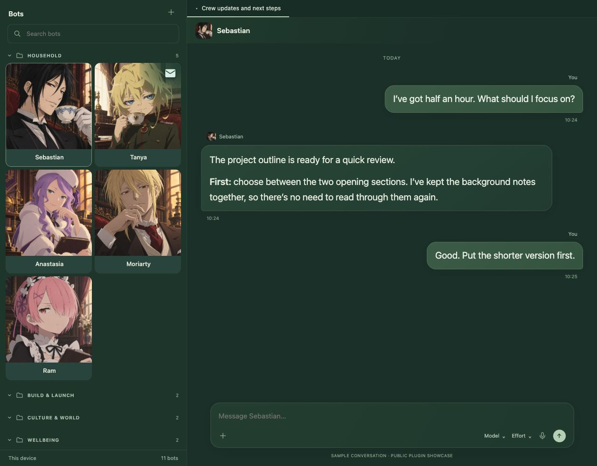
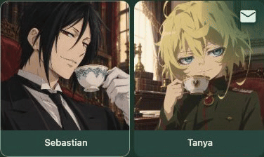

# Inner Circle Preview

**Sharing for inspiration.** This is an early community design experiment for
Hermes Desktop. If there is interest, we can polish it further together.

[Folders and crew](demo/folders.jpg) · [Compact sidebar](demo/compact-current.jpg) · [Watch the updated showcase](demo/showcase.mp4)

*Rendered with the public plugin, the configured character artwork and sample
conversation text. The gallery uses two 185px portraits per row with 20px chat
text, so the artwork and conversation remain readable together.*

*The pale sage envelope clears as its bot becomes selected. Portraits, caption
bars and names keep their positions; the bar stays deep forest.*

An optional sage theme and desktop plugin, adapted from work with
[Hermes Bot Kit](https://github.com/thomasbek3/hermes-bot-kit).

- Large edge-to-edge portraits, full-width forest caption bars and a subtle
  selection edge around the current bot.
- A prominent filled sage envelope for native unread replies. Quiet/read bots
  have no dot; working, approval, stalled and background indicators stay native.
  Opening a bot fades the unread cue without changing the card layout.
- Compact icon-and-name rows when the native roster narrows below 220 CSS px.
- Drag to reorder within a folder, or use Alt+Up / Alt+Down. Order stays local to
  the desktop; the reset command restores native sorting. Cross-folder moves
  remain native. Browsers without CSS reading-flow retain native ordering.
- Activity ages advance from the native roster cache without opening each bot.
- Compact selected-bot header, titles that use the available width, dark sage
  messages and a narrower composer. Optional Sessions hiding stays off by default.

The native roster, folder membership, status engine, menus and conversation
history remain in Hermes. The plugin does not create bots, send messages, run routines or alter
model settings. It uses native read-only registry metadata to identify a local
canonical Bot Chat. Ambiguous matches and remote chat sources keep stock styling.

## Try the preview

This is a manually installed experiment, not a stable release or an installer.
Use a disposable Hermes setup first. It targets the native DOM/SDK inspected in
Hermes v0.22.5; older/newer builds may render stock when their hooks differ.

1. Copy `plugin.js` to your Hermes app home's
   `desktop-plugins/inner-circle-preview/plugin.js` (normally under `~/.hermes`).
   Preserve an existing folder before replacing it. This is app-level, not a
   per-profile plugin. Avoid enabling it alongside another roster/chat reskin.
2. Reload desktop plugins from the command palette. Enable **Inner Circle
   Preview** in Settings → Plugins; it is disabled by default.
3. Optional: copy `inner-circle-sage.yaml` to your Hermes home's `skins/` folder,
   then select it with `hermes config set display.skin inner-circle-sage`.
   Record your previous skin first. The plugin itself does not change it.
4. Open a bot's native Bot Chat. Narrow/widen the sidebar using its divider.
   **Inner Circle Preview: show or hide Sessions** is available in the palette.
   **Inner Circle Preview: reset custom bot order** restores native ordering.

For larger conversation text without enlarging the sidebar, use Hermes Settings
→ Appearance → Typography → Chat Text Size. UI Scale changes the whole app.

To remove it, disable the plugin, remove its folder and reload plugins. Select
your previous skin before removing the optional skin file. No session or profile
data needs to be deleted or restored.

## Demo and checks

`demo/index.html` runs the public plugin against native-shaped sample markup,
with a browser-only SDK stub in `demo/sdk.js`. It has no Hermes connection and
cannot send a message. Serve the repository locally, for example
`python3 -m http.server 8766`, then open `http://127.0.0.1:8766/demo/`.
Select bots, fold folders, drag the divider, or try `?compact=1` for compact rows.
The controls below the showcase include a scrubber for inspecting the unread
transition. The GIF sequences these rendered intermediate states; the MP4 is an
illustrated tour of the same browser views, not a live-model recording.

The current captures use a 1280 × 1000 showcase with 20px sample chat text. The
character portraits are AI-generated fan illustrations from the configured
profiles; see [demo/ASSETS.md](demo/ASSETS.md). Earlier canvas exports remain in
Git history and the previous media files; the images above show this revision.

For the isolated tests, install the development dependency with `npm install`,
then run `npm test`. The plugin has no runtime npm dependency or build step.

The original customized Mac setup was visually checked at narrow and wide
widths. This extracted preview has 17 isolated checks covering registry/scope,
stale reads, avatar updates, cleanup, saved folder ordering, advancing ages,
native unread changes and suppression for the current source-qualified bot.
The browser showcase was checked at gallery and compact widths, including
keyboard reorder and unchanged card bounds when opening an unread bot. A clean stock-Hermes acceptance pass and
Windows/Linux visual acceptance have **not** been completed for this extraction.
CSS depends on native markup and can need adjustment after Hermes updates.

## Scope and future interest

This first public slice is presentation only. The original setup also had
evidence-backed Telegram badges and folded routine records; those depend on a
private integration and are deliberately not included or simulated as shipped
features here. A portable, optional adapter could follow if people want it.

Useful feedback: preferred gallery/list breakpoint, keyboard/accessibility
behaviour, light-theme treatment and compatibility with current Hermes builds.
This remains a design experiment shared for inspiration, with further polish
if there is interest.

## Credits

Thanks to Thomas Bekkers for [Hermes Bot Kit](https://github.com/thomasbek3/hermes-bot-kit)
and Nous Research for [Hermes](https://github.com/NousResearch/hermes-agent).
MIT; see [LICENSE](LICENSE) and [NOTICE](NOTICE). Independent community work,
not affiliated with Nous Research or xAI.
