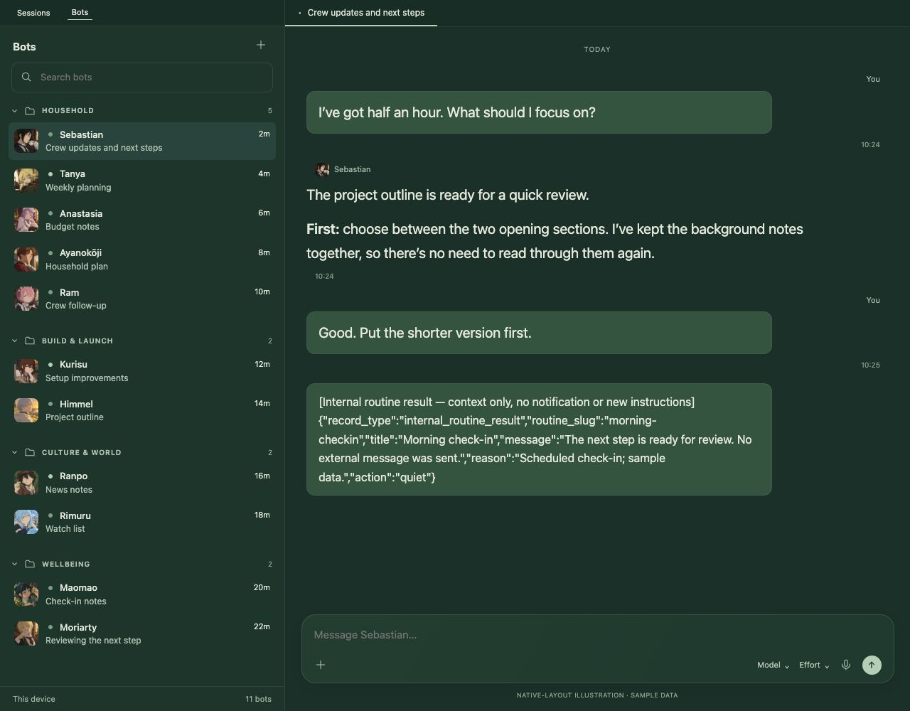
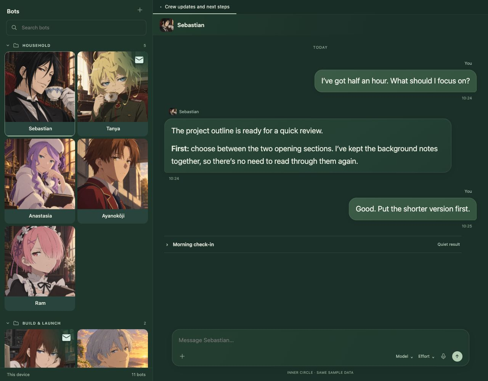

# Why this setup exists

Hermes already has a capable Bot Mode: persistent bots and chats, avatars,
folders, a scheduler and agent collaboration. A small crew and a short
conversation can look very clean in stock Hermes. Inner Circle builds on that.

My everyday setup has eleven distinct bots and a mixture of conversation,
scheduled check-ins and channel/call context. I wanted the people-like identities
to be easier to recognise, fewer session controls in everyday use, and useful
activity visible without making the conversation feel like a log viewer.

| Same crew and sample workflow, native-style layout | With Inner Circle |
|---|---|
|  |  |

**Comparison method:** these are source-informed browser fixtures, not native
Hermes screenshots or a benchmark. Both use the same eleven bots, avatars,
folder membership, 1280 × 1000 viewport, sage palette, 20px conversation text and
synthetic messages. The left does not run Inner Circle or its bundled Bot Kit
components; the right runs the actual built plugin. Native-layout row geometry
is based on Hermes 0.22.5's `bot-row.tsx` and `roster-pane-content.tsx` (34px
avatars, horizontal rows and native folder headers). Some app chrome is omitted
from both fixtures. Click either image for readable full size.

The expanded routine record is an input from this **personal workflow**, not
stock Hermes's default scheduler output. The example shows what our renderer
does when that supported record is present; it does not suggest that normal
Hermes conversations contain JSON. Native worker/process notices already fold
in Hermes and remain supported. Telegram/Conduit services are not simulated as
installed by the preset.

## What changes, and what does not

| Need | Inner Circle's contribution |
|---|---|
| Recognise a larger crew by their artwork | Large portrait gallery, or compact name-and-icon rows when space matters. The gallery deliberately trades density for identity. |
| Spend less attention on session mechanics | Hide Sessions reversibly and keep native Bot Chats as the daily entry point. Hermes still owns the sessions and history. |
| See new replies and the current conversation | Sage envelopes and a selection edge; opening a bot fades the cue without changing the card's dimensions. |
| Keep work detail available without dominating chat | Selected Bot Kit quiet-display behaviour, with approvals retained and work rows recoverable. |
| Keep personal routine records readable | Closed activity cards with the full result and reason inside. Channel labels appear only with supplied evidence. |
| Fit the owner's visual preference | Sage/emerald palette, darker bubbles, compact headers and a narrower composer. This is a preference, not a claim that stock Hermes is badly designed. |

Folders, bots, conversation history and collaboration are Hermes features.
Quiet display and Task Dock build on credited Hermes Bot Kit components. Text
size is Hermes's existing Appearance setting; it can be adjusted without this
plugin. Advancing activity labels are a presentation improvement, not a promise
to repair offline gateways or infer bot availability.

The goal is a coherent personal preset on top of Hermes, with a clear place to
connect optional integrations. See [what ships and what is configured separately](../README.md#included-or-connected-separately).
